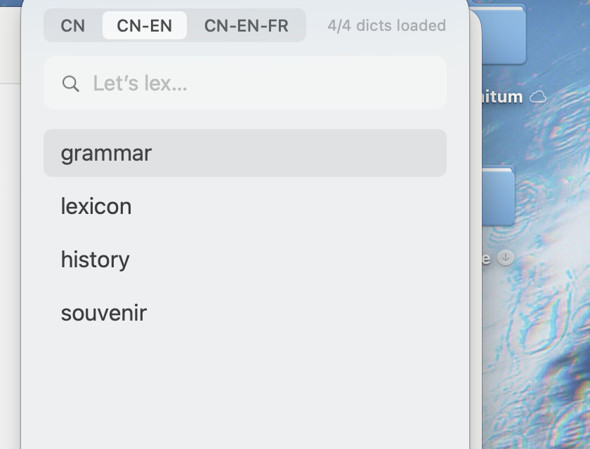

# Lexique

A small, fast macOS dictionary for your own MDX files. Press **⌥Space**, type a word, read the entry.

Built because a menu-bar dictionary shouldn't need a family of background helpers, accessibility permissions, or an account. Lexique is one process, reads your dictionaries in place, and does nothing else.



## Features

- Global hotkey **⌥Space**; the panel opens under the menu bar icon, remembers its size and position.
- Dictionary **groups** (`CN`, `CN-EN`, `CN-EN-FR`, …) defined in a plain text file; switch with one click, each group keeps its own history.
- Prefix search across the group, fuzzy on case and diacritics; `↑`/`↓` to choose, `Return` to open, `Esc` to go back.
- Entries render as the dictionary intended: CSS, images from MDD, `entry://` cross-links.
- British and American IPA with system TTS (no bundled audio).
- History: latest 100 in the UI, full log appended to plain text files by day.
- Release a group's cache (and its memory) from the menu; click the group again to reload.
- Read-only: Lexique never copies or modifies your dictionary files.

## Requirements

- macOS 14 or later (tested on macOS 27, Apple Silicon).
- Your own `.mdx` dictionaries. None are bundled.

## Build

No Xcode required; the Command Line Tools are enough.

```sh
./build.sh          # builds and installs /Applications/Lexique.app
open /Applications/Lexique.app
```

The app is ad-hoc signed. If macOS refuses the first launch, right-click → Open, or:

```sh
xattr -dr com.apple.quarantine /Applications/Lexique.app
```

## Dictionaries

Put your `.mdx` files (and matching `.mdd`) in:

```
~/Library/Application Support/Lexique/Dictionaries/
```

Group and order them in `order.txt` in the same folder:

```text
default = CN-EN

[CN]
汉语辞海

[CN-EN]
Oxford Advanced Learner's English-Chinese Diction
Merriam-Webster's Collegiate Dictionary 11th Edtion

[CN-EN-FR]
拉鲁斯英法法英词典
法汉汉法词典
```

- `[Group]` starts a group; one dictionary per line, first line wins when several have the same headword.
- `default = Group` chooses the group loaded at launch.
- Dictionaries not listed are appended to the first group.

## Not included, by design

Mouse-over lookup, screen OCR, clipboard monitoring, accessibility permissions, word books, spaced repetition, cloud sync, online dictionaries, AI translation, bundled pronunciation audio.

## Credits

- [OpenMDict](https://github.com/naco-siren/OpenMDict) — MIT, the pure-Swift MDX/MDD parser (vendored under `Vendor/OpenMDict`).
- [ipa-dict](https://github.com/open-dict-data/ipa-dict) — MIT, British and American IPA data (`Resources/en_UK.txt`, `en_US.txt`).

## License

MIT. See [LICENSE](LICENSE).
