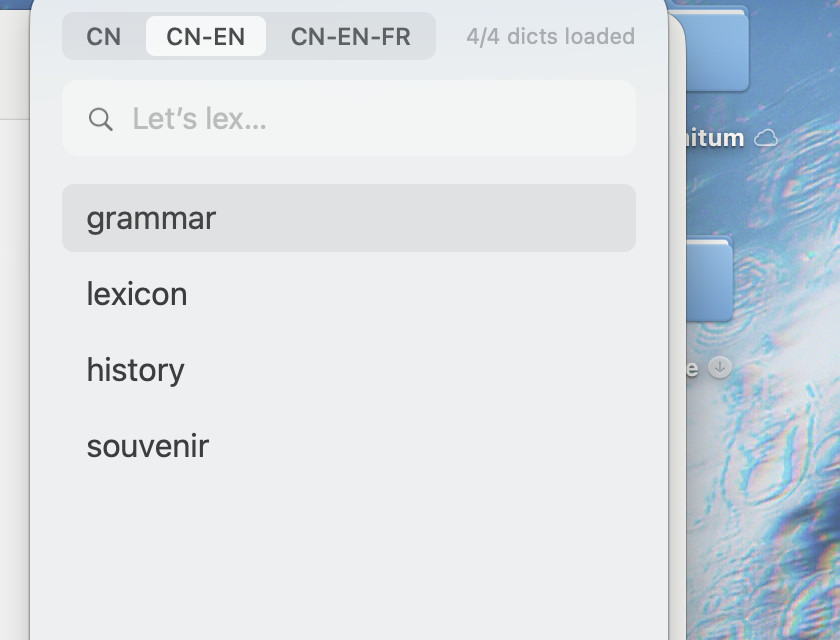

# Lexique

[English](README.md) | 中文

一个给自用 MDX 词典的 macOS 小工具。按 **⌥Space**，输入单词，看释义。

做它的原因很简单：一个菜单栏词典不该带一窝后台助手、不该要辅助功能权限、也不该要账号。Lexique 只有一个进程，就地读你的词典，别的不做。



## 功能

- 全局热键 **⌥Space**；浮窗从菜单栏图标下方弹出，记住尺寸与位置。
- **词典分组**（`CN`、`CN-EN`、`CN-EN-FR`……）写在纯文本里，一键切换，各组历史互不干扰。
- 组内前缀检索，大小写与变音符号自动折叠；`↑`/`↓` 选择，`Return` 打开，`Esc` 返回。
- 词条按词典原本的样子渲染：CSS、MDD 里的图片、`entry://` 交叉跳转。
- 英式／美式音标，发音交给系统 TTS（不打包音频）。
- 历史：界面显示最近 100 条，磁盘上按天全量追加到纯文本。
- 菜单里可以释放某一组的缓存与内存；再点该组即可重新加载。
- 只读：Lexique 从不复制、也不修改你的词典文件。

## 环境

- macOS 14 及以上（在 macOS 27 / Apple Silicon 实测）。
- 自备 `.mdx` 词典；不内置任何词库。

## 构建

不需要 Xcode，Command Line Tools 就够。

```sh
./build.sh          # 构建并安装到 /Applications/Lexique.app
open /Applications/Lexique.app
```

应用是 ad-hoc 签名。若首次启动被系统拦截，右键 → 打开，或：

```sh
xattr -dr com.apple.quarantine /Applications/Lexique.app
```

## 词典

把 `.mdx`（及同名 `.mdd`）放进：

```
~/Library/Application Support/Lexique/Dictionaries/
```

在同一目录的 `order.txt` 里分组、排序：

```text
default = CN-EN

[CN]
汉语辞海

[CN-EN]
Oxford Advanced Learner's English-Chinese Diction
Merriam-Webster's Collegiate Dictionary 11th Edtion

[CN-EN-FR]
拉鲁斯英法法英词典
法汉汉法词典
```

- `[组名]` 开一节；一行一部词典，排在前面的优先。
- `default = 组名` 指定启动时加载哪一组。
- 没有列出的词典会自动追加到第一组。

## 刻意不做

鼠标悬停取词、屏幕 OCR、剪贴板监听、辅助功能权限、生词本、间隔重复、云同步、在线词典、AI 翻译、内置发音音频。

## 致谢

- 由 **TGE**（和 **lithen**）工程实现。
- [OpenMDict](https://github.com/naco-siren/OpenMDict) — MIT，纯 Swift 的 MDX/MDD 解析器（vendored 于 `Vendor/OpenMDict`）。
- [ipa-dict](https://github.com/open-dict-data/ipa-dict) — MIT，英式／美式音标数据（`Resources/en_UK.txt`、`en_US.txt`）。

## 许可

MIT，见 [LICENSE](LICENSE)。
